# Activity Diagram
## Sistem Informasi RS Sehat Selalu

---

## 1. Activity Diagram - Pendaftaran Akun Pasien

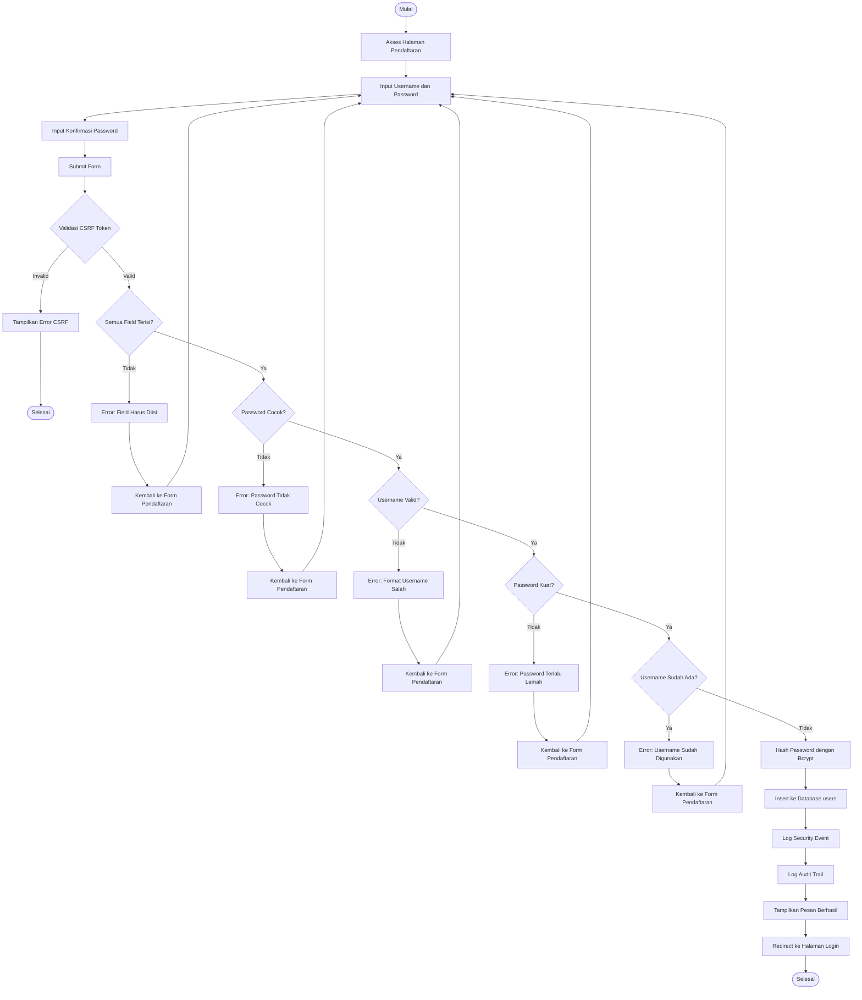

---

## 2. Activity Diagram - Login Pasien/Admin

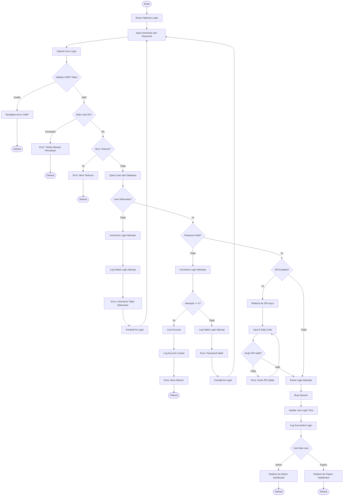

---

## 3. Activity Diagram - Login Dokter

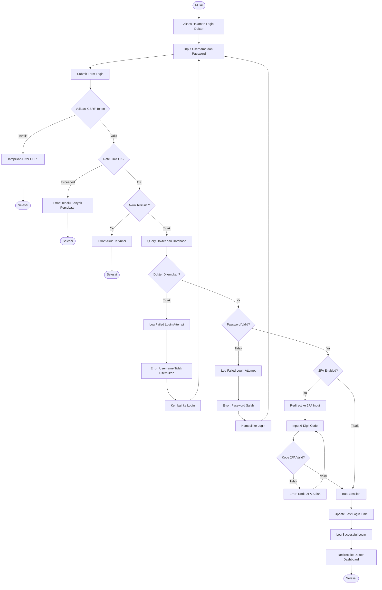

---

## 4. Activity Diagram - Booking Janji Dokter (Pasien)

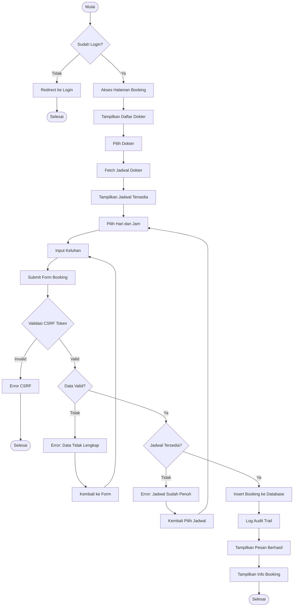

---

## 5. Activity Diagram - Lihat Booking (Dokter)

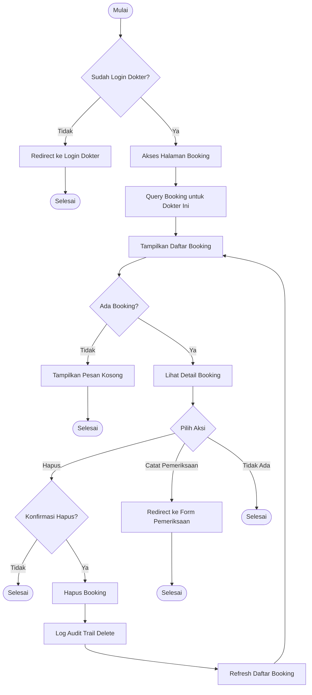

---

## 6. Activity Diagram - Catat Pemeriksaan (Dokter)

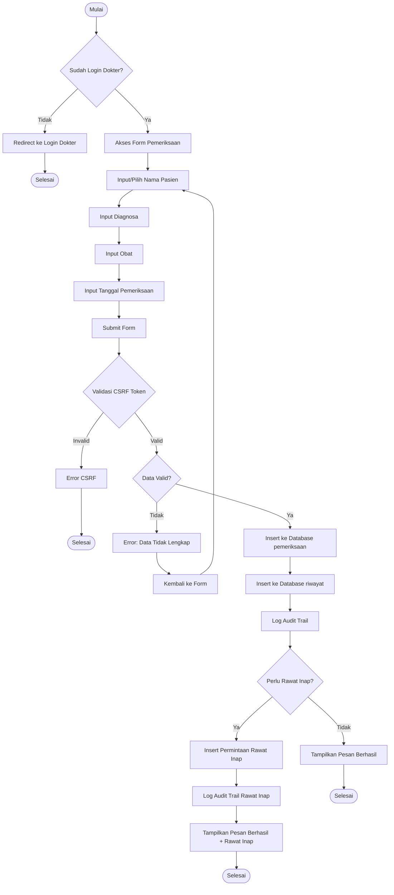

---

## 7. Activity Diagram - Kelola Rawat Inap (Admin)

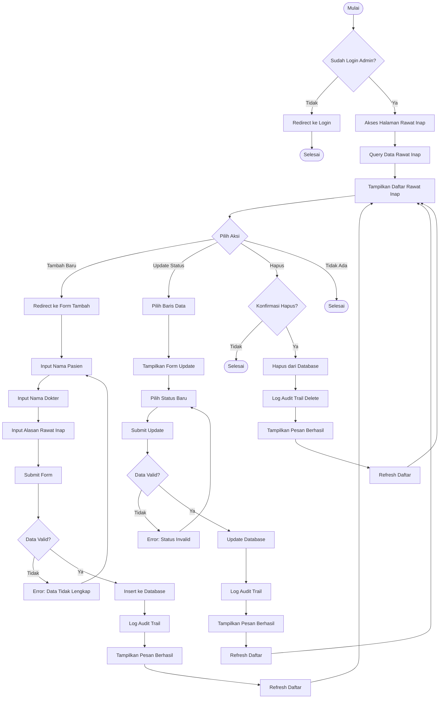

---

## 8. Activity Diagram - Kelola Pembayaran (Admin)

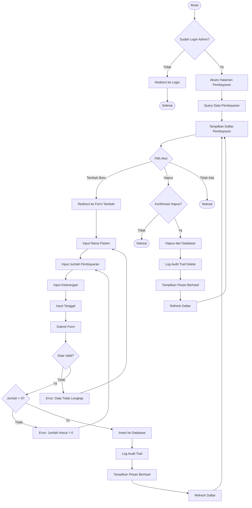

---

## 9. Activity Diagram - Lihat Riwayat Medis (Pasien)

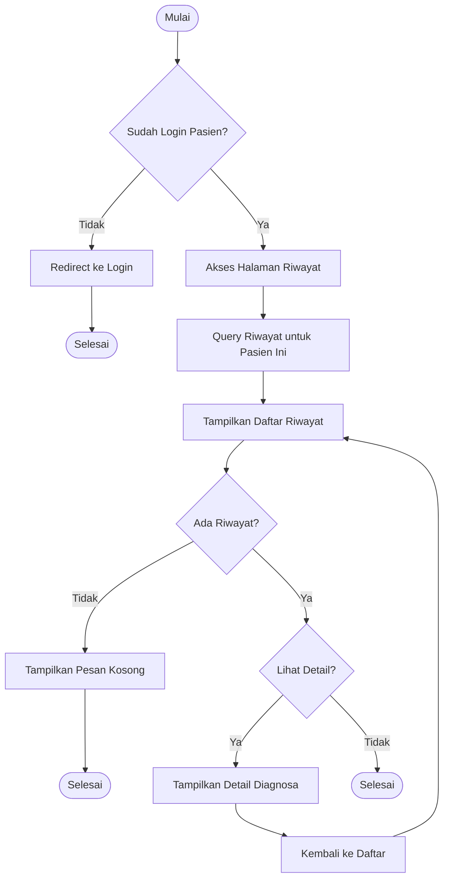

---

## 10. Activity Diagram - Setup 2FA (Two-Factor Authentication)

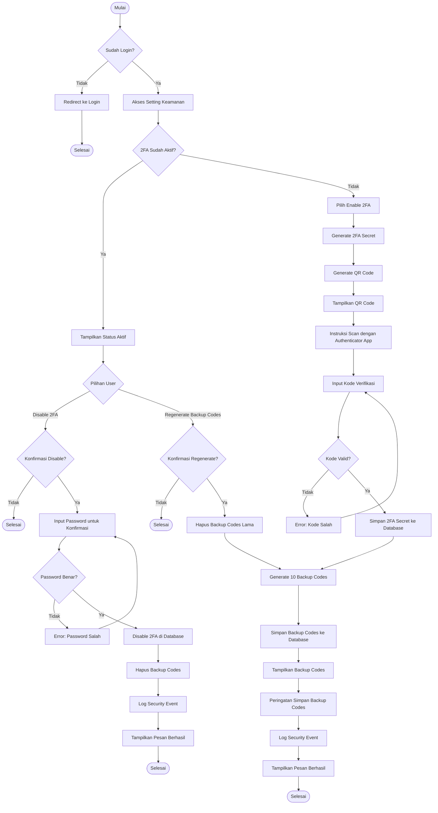

---

## 11. Activity Diagram - Reset Password

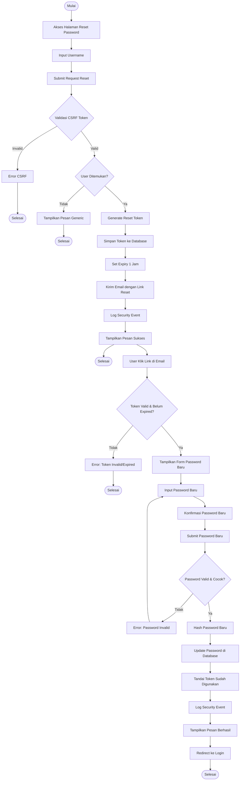

---

## 12. Activity Diagram - Logout

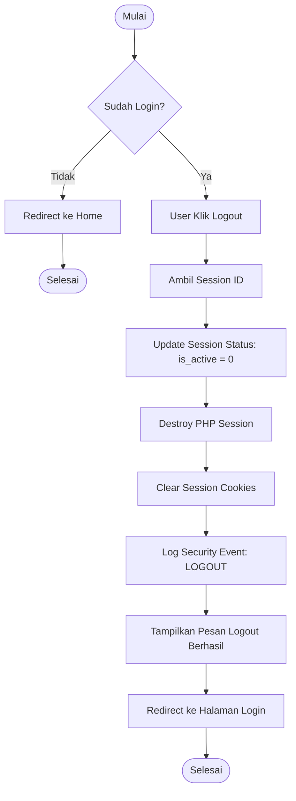

---

## 13. Activity Diagram - Admin Kelola Booking

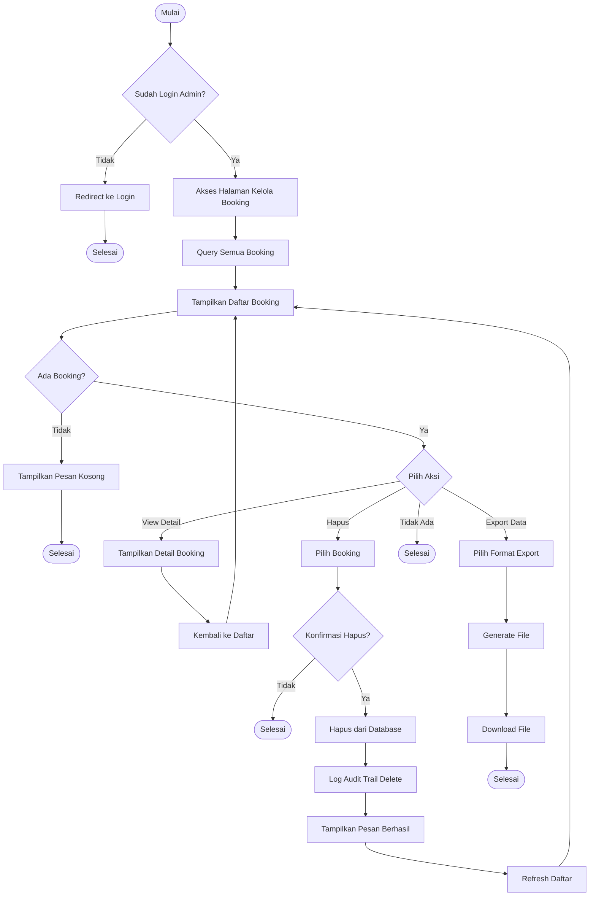

---

## 14. Activity Diagram - Dokter Kelola Jadwal

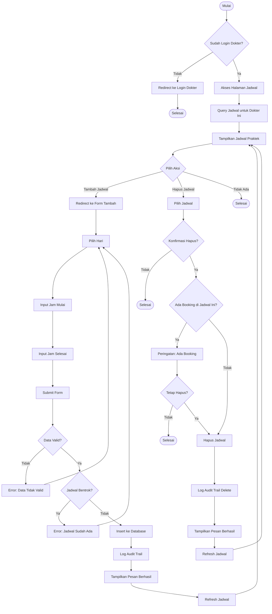

---

## Penjelasan Activity Diagram

### Simbol yang Digunakan:
- **Start/End (Rounded Rectangle):** Titik mulai dan selesai
- **Process (Rectangle):** Proses/aksi yang dilakukan sistem
- **Decision (Diamond):** Keputusan/kondisi dengan cabang Ya/Tidak
- **Arrow:** Alur proses

### Fitur Keamanan yang Tercakup:
1. **CSRF Token Validation** - Semua form divalidasi
2. **Rate Limiting** - Mencegah brute force attack
3. **Account Locking** - Setelah 5x percobaan gagal
4. **Two-Factor Authentication (2FA)** - Lapisan keamanan tambahan
5. **Password Hashing** - Bcrypt untuk menyimpan password
6. **Security Logging** - Semua event keamanan dicatat
7. **Audit Trail** - Semua perubahan data dicatat
8. **Session Management** - Tracking sesi aktif
9. **Password Reset** - Dengan token expiry
10. **Input Validation** - Semua input divalidasi

### Proses Utama:
1. **Autentikasi** - Login, Logout, 2FA
2. **Manajemen Pasien** - Pendaftaran, Booking, Riwayat
3. **Manajemen Dokter** - Login, Lihat Booking, Catat Pemeriksaan, Kelola Jadwal
4. **Manajemen Admin** - Kelola Booking, Pembayaran, Rawat Inap
5. **Keamanan** - Setup 2FA, Reset Password, Logout

---

**Dibuat untuk:** RS Sehat Selalu  
**Format:** Mermaid Flowchart  
**Tanggal:** 2025
