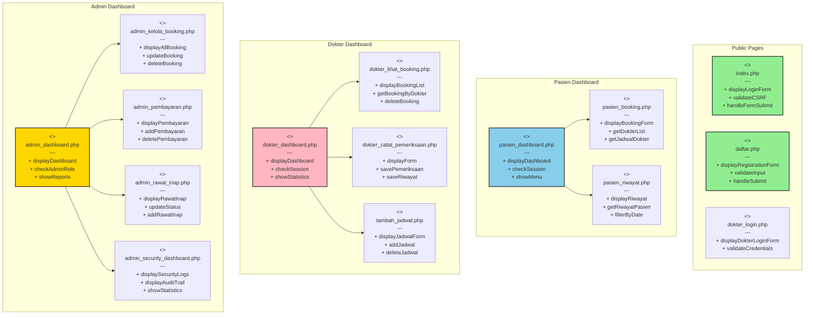
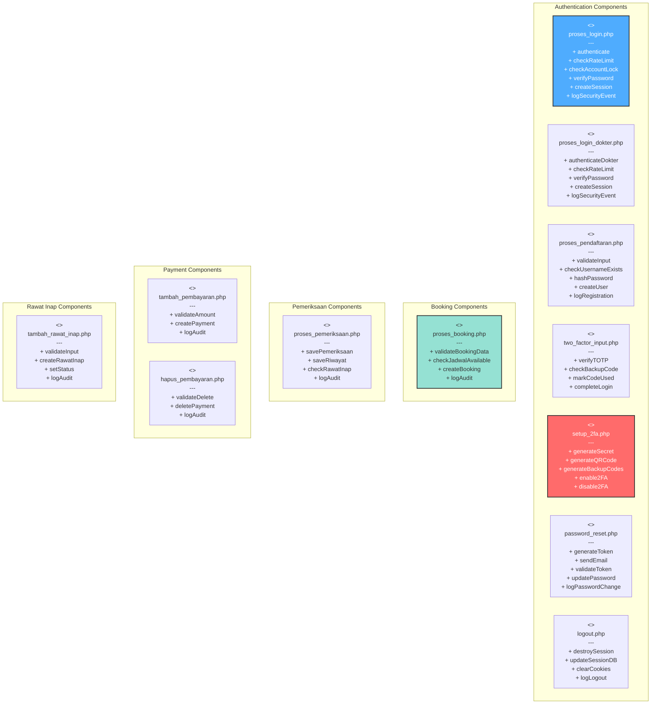
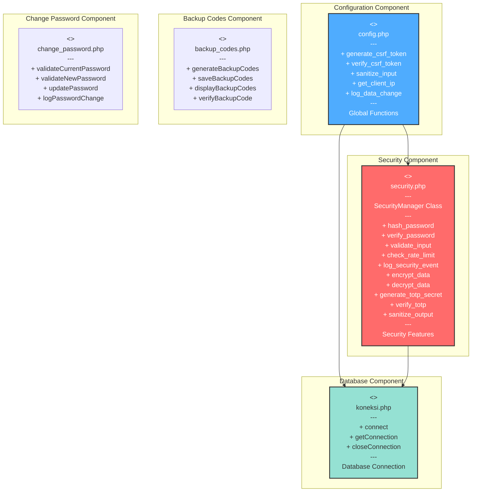
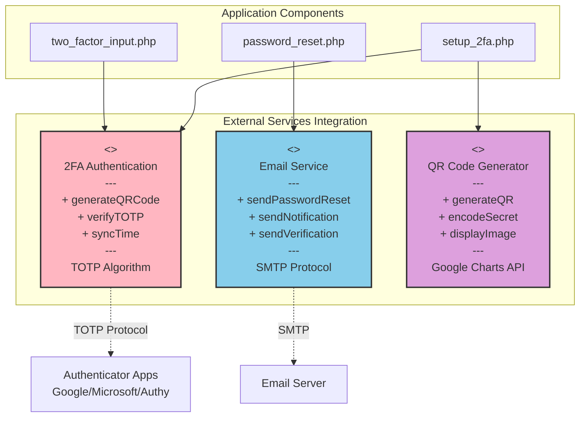
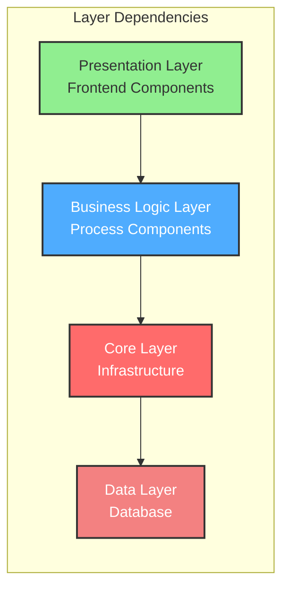

# Component Diagram
## Sistem Informasi RS Sehat Selalu

---

## Component Diagram - Arsitektur Sistem Keseluruhan

```mermaid
graph TB
    subgraph "Client Layer / Presentation Layer"
        WebBrowser[Web Browser]
        MobileDevice[Mobile Device]
    end
    
    subgraph "Application Server / Web Server"
        subgraph "Frontend Components"
            IndexPage[index.php<br/>Login Page]
            DaftarPage[daftar.php<br/>Registration Page]
            AdminDashboard[admin_dashboard.php]
            PasienDashboard[pasien_dashboard.php]
            DokterDashboard[dokter_dashboard.php]
        end
        
        subgraph "Authentication Components"
            ProsesLogin[proses_login.php]
            ProsesLoginDokter[proses_login_dokter.php]
            ProsesPendaftaran[proses_pendaftaran.php]
            TwoFactorInput[two_factor_input.php]
            Setup2FA[setup_2fa.php]
            PasswordReset[password_reset.php]
            Logout[logout.php]
        end
        
        subgraph "Pasien Management Components"
            PasienBooking[pasien_booking.php]
            ProsesBooking[proses_booking.php]
            PasienRiwayat[pasien_riwayat.php]
        end
        
        subgraph "Dokter Management Components"
            DokterLihatBooking[dokter_lihat_booking.php]
            DokterCatatPemeriksaan[dokter_catat_pemeriksaan.php]
            TambahJadwal[tambah_jadwal.php]
            DokterRawatInap[dokter_rawat_inap.php]
        end
        
        subgraph "Admin Management Components"
            AdminKelolaBooking[admin_kelola_booking.php]
            AdminPembayaran[admin_pembayaran.php]
            TambahPembayaran[tambah_pembayaran.php]
            HapusPembayaran[hapus_pembayaran.php]
            AdminRawatInap[admin_rawat_inap.php]
            TambahRawatInap[tambah_rawat_inap.php]
            AdminRiwayatDiagnosa[admin_riwayat_diagnosa.php]
            AdminSecurityDashboard[admin_security_dashboard.php]
        end
        
        subgraph "Core Components"
            Config[config.php<br/>Configuration]
            Security[security.php<br/>Security Class]
            Koneksi[koneksi.php<br/>Database Connection]
        end
    end
    
    subgraph "Database Layer"
        MySQL[(MySQL/MariaDB<br/>Database)]
    end
    
    subgraph "External Services"
        EmailService[Email Service<br/>SMTP]
        AuthApp[Authenticator App<br/>Google/Microsoft]
    end
    
    %% Client to Frontend
    WebBrowser --> IndexPage
    WebBrowser --> DaftarPage
    WebBrowser --> AdminDashboard
    WebBrowser --> PasienDashboard
    WebBrowser --> DokterDashboard
    MobileDevice --> IndexPage
    
    %% Frontend to Auth
    IndexPage --> ProsesLogin
    DaftarPage --> ProsesPendaftaran
    IndexPage --> ProsesLoginDokter
    ProsesLogin --> TwoFactorInput
    ProsesLoginDokter --> TwoFactorInput
    AdminDashboard --> Setup2FA
    PasienDashboard --> Setup2FA
    DokterDashboard --> Setup2FA
    
    %% Frontend to Pasien Management
    PasienDashboard --> PasienBooking
    PasienBooking --> ProsesBooking
    PasienDashboard --> PasienRiwayat
    
    %% Frontend to Dokter Management
    DokterDashboard --> DokterLihatBooking
    DokterDashboard --> DokterCatatPemeriksaan
    DokterDashboard --> TambahJadwal
    DokterCatatPemeriksaan --> DokterRawatInap
    
    %% Frontend to Admin Management
    AdminDashboard --> AdminKelolaBooking
    AdminDashboard --> AdminPembayaran
    AdminPembayaran --> TambahPembayaran
    AdminPembayaran --> HapusPembayaran
    AdminDashboard --> AdminRawatInap
    AdminRawatInap --> TambahRawatInap
    AdminDashboard --> AdminRiwayatDiagnosa
    AdminDashboard --> AdminSecurityDashboard
    
    %% All components use Core
    ProsesLogin --> Config
    ProsesLogin --> Security
    ProsesPendaftaran --> Config
    ProsesPendaftaran --> Security
    ProsesBooking --> Config
    ProsesBooking --> Security
    DokterCatatPemeriksaan --> Config
    DokterCatatPemeriksaan --> Security
    AdminKelolaBooking --> Config
    AdminKelolaBooking --> Security
    
    %% Core to Database
    Config --> Koneksi
    Koneksi --> MySQL
    
    %% External Services
    Setup2FA --> AuthApp
    PasswordReset --> EmailService
    TwoFactorInput --> AuthApp
    
    style Config fill:#4facfe,stroke:#333,stroke-width:2px,color:#fff
    style Security fill:#ff6b6b,stroke:#333,stroke-width:2px,color:#fff
    style Koneksi fill:#95e1d3,stroke:#333,stroke-width:2px
    style MySQL fill:#f38181,stroke:#333,stroke-width:2px,color:#fff
```



---

## Component Diagram - Presentation Layer (Frontend)



---

## Component Diagram - Business Logic Layer



---

## Component Diagram - Core/Infrastructure Layer



---

## Component Diagram - Database Layer

```mermaid
graph TB
    subgraph "Database Management System"
        MySQL[(MySQL/MariaDB<br/>Database Server)]
    end
    
    subgraph "Core Tables"
        Users[<<table>><br/>users<br/>---<br/>+ id PK<br/>+ username UK<br/>+ password<br/>+ role<br/>+ 2fa_secret<br/>+ 2fa_enabled]
        
        Dokter[<<table>><br/>dokter<br/>---<br/>+ id PK<br/>+ username<br/>+ password<br/>+ nama<br/>+ 2fa_secret<br/>+ 2fa_enabled]
    end
    
    subgraph "Operational Tables"
        Booking[<<table>><br/>booking<br/>---<br/>+ id PK<br/>+ pasien<br/>+ dokter<br/>+ tanggal<br/>+ hari<br/>+ jam<br/>+ keluhan]
        
        Pemeriksaan[<<table>><br/>pemeriksaan<br/>---<br/>+ id PK<br/>+ pasien<br/>+ dokter<br/>+ diagnosa<br/>+ obat<br/>+ tanggal]
        
        Pembayaran[<<table>><br/>pembayaran<br/>---<br/>+ id PK<br/>+ pasien<br/>+ jumlah<br/>+ keterangan<br/>+ tanggal]
        
        RawatInap[<<table>><br/>rawat_inap<br/>---<br/>+ id PK<br/>+ pasien<br/>+ dokter<br/>+ alasan<br/>+ status<br/>+ tanggal]
        
        Riwayat[<<table>><br/>riwayat<br/>---<br/>+ id PK<br/>+ pasien<br/>+ dokter<br/>+ tanggal<br/>+ diagnosa]
        
        DokterJadwal[<<table>><br/>dokter_jadwal<br/>---<br/>+ id PK<br/>+ dokter<br/>+ hari<br/>+ jam]
    end
    
    subgraph "Security Tables"
        SecurityLogs[<<table>><br/>security_logs<br/>---<br/>+ id PK<br/>+ user_id FK<br/>+ event_type<br/>+ details<br/>+ ip_address<br/>+ timestamp]
        
        AuditLogs[<<table>><br/>audit_logs<br/>---<br/>+ id PK<br/>+ table_name<br/>+ record_id<br/>+ action<br/>+ old_values<br/>+ new_values<br/>+ user_id FK]
        
        LoginAttempts[<<table>><br/>login_attempts<br/>---<br/>+ id PK<br/>+ identifier<br/>+ ip_address<br/>+ success<br/>+ timestamp]
        
        UserSessions[<<table>><br/>user_sessions<br/>---<br/>+ id PK<br/>+ user_id FK<br/>+ session_id<br/>+ ip_address<br/>+ expires_at<br/>+ is_active]
        
        BackupCodesTable[<<table>><br/>backup_codes<br/>---<br/>+ id PK<br/>+ user_id FK<br/>+ code<br/>+ used<br/>+ created_at]
        
        PasswordResetTokens[<<table>><br/>password_reset_tokens<br/>---<br/>+ id PK<br/>+ user_id FK<br/>+ token<br/>+ expires_at<br/>+ used]
        
        EncryptedData[<<table>><br/>encrypted_data<br/>---<br/>+ id PK<br/>+ table_name<br/>+ record_id<br/>+ field_name<br/>+ encrypted_value]
    end
    
    MySQL --> Users
    MySQL --> Dokter
    MySQL --> Booking
    MySQL --> Pemeriksaan
    MySQL --> Pembayaran
    MySQL --> RawatInap
    MySQL --> Riwayat
    MySQL --> DokterJadwal
    MySQL --> SecurityLogs
    MySQL --> AuditLogs
    MySQL --> LoginAttempts
    MySQL --> UserSessions
    MySQL --> BackupCodesTable
    MySQL --> PasswordResetTokens
    MySQL --> EncryptedData
    
    style MySQL fill:#f38181,stroke:#333,stroke-width:3px,color:#fff
    style Users fill:#95e1d3,stroke:#333,stroke-width:2px
    style SecurityLogs fill:#ff6b6b,stroke:#333,stroke-width:2px,color:#fff
    style AuditLogs fill:#ff6b6b,stroke:#333,stroke-width:2px,color:#fff
```



---

## Component Diagram - Integration Layer



---

## Component Interface Details

### 1. **Authentication Components**

#### proses_login.php
```php
<<component>>
Provides: IAuthentication
Requires: IDatabase, ISecurity, ISession

Methods:
+ authenticate(username, password): boolean
+ checkRateLimit(identifier): boolean
+ checkAccountLock(userId): boolean
+ verifyPassword(plain, hash): boolean
+ createSession(userId): sessionId
+ logSecurityEvent(userId, event): void
```

#### security.php
```php
<<component>>
Provides: ISecurity
Requires: IDatabase

Methods:
+ hash_password(password): string
+ verify_password(password, hash): boolean
+ validate_input(input, type): boolean
+ check_rate_limit(identifier, limit): boolean
+ log_security_event(userId, event, details): void
+ encrypt_data(data, key): string
+ decrypt_data(encrypted, key): string
+ generate_totp_secret(): string
+ verify_totp(secret, code): boolean
+ sanitize_output(data): string
```

### 2. **Business Logic Components**

#### proses_booking.php
```php
<<component>>
Provides: IBooking
Requires: IDatabase, ISecurity, IAudit

Methods:
+ validateBookingData(data): boolean
+ checkJadwalAvailable(dokter, hari, jam): boolean
+ createBooking(pasien, dokter, tanggal, hari, jam, keluhan): boolean
+ logAudit(action, data): void
```

#### dokter_catat_pemeriksaan.php
```php
<<component>>
Provides: IPemeriksaan
Requires: IDatabase, ISecurity, IAudit

Methods:
+ savePemeriksaan(pasien, dokter, diagnosa, obat): boolean
+ saveRiwayat(pasien, dokter, diagnosa): boolean
+ checkRawatInap(): boolean
+ logAudit(action, data): void
```

### 3. **Core Components**

#### config.php
```php
<<component>>
Provides: IConfiguration
Requires: IDatabase

Functions:
+ generate_csrf_token(): string
+ verify_csrf_token(token): boolean
+ sanitize_input(input): string
+ get_client_ip(): string
+ log_data_change(table, recordId, action, oldValues, newValues, userId): void
```

#### koneksi.php
```php
<<component>>
Provides: IDatabase
Requires: None

Methods:
+ connect(): mysqli
+ getConnection(): mysqli
+ closeConnection(): void
+ query(sql): result
+ prepare(sql): statement
```

---

## Component Dependencies



---

## Component Package Structure

```
rs_sehat_selalu/
│
├── Frontend Components (Presentation)
│   ├── index.php
│   ├── daftar.php
│   ├── dokter_login.php
│   ├── admin_dashboard.php
│   ├── pasien_dashboard.php
│   ├── dokter_dashboard.php
│   └── ...
│
├── Business Logic Components
│   ├── proses_login.php
│   ├── proses_login_dokter.php
│   ├── proses_pendaftaran.php
│   ├── proses_booking.php
│   ├── two_factor_input.php
│   ├── setup_2fa.php
│   ├── password_reset.php
│   └── ...
│
├── Core Components (Infrastructure)
│   ├── config.php
│   ├── security.php
│   ├── koneksi.php
│   ├── backup_codes.php
│   └── change_password.php
│
├── Database Scripts
│   ├── rs_sehat_selalu.sql
│   ├── security_upgrade.sql
│   └── simple_upgrade.sql
│
└── Assets
    ├── dokter.png
    ├── rumah sakit.jpg
    └── particles.js
```

---

## Component Characteristics

### **Coupling & Cohesion:**
- ✅ **Low Coupling:** Components are loosely coupled through interfaces
- ✅ **High Cohesion:** Each component has single responsibility
- ✅ **Separation of Concerns:** Clear layer separation

### **Reusability:**
- ✅ **Security Component:** Used by all business logic components
- ✅ **Config Component:** Shared configuration management
- ✅ **Database Component:** Centralized data access

### **Maintainability:**
- ✅ **Modular Design:** Easy to modify individual components
- ✅ **Clear Interfaces:** Well-defined component contracts
- ✅ **Consistent Patterns:** Similar structure across components

### **Security Features:**
- 🔒 **CSRF Protection** in all forms
- 🔒 **Rate Limiting** in authentication
- 🔒 **2FA Support** for enhanced security
- 🔒 **Audit Logging** for compliance
- 🔒 **Session Management** for user tracking
- 🔒 **Password Hashing** with bcrypt
- 🔒 **Data Encryption** for sensitive data

### **Scalability:**
- ✅ **Stateless Components:** Easy to scale horizontally
- ✅ **Database Connection Pooling:** Efficient resource usage
- ✅ **Session Management:** Distributed session support

---

## Component Communication Patterns

### 1. **Synchronous Communication:**
- Frontend → Business Logic: HTTP POST/GET
- Business Logic → Core: Function calls
- Core → Database: SQL queries

### 2. **Data Flow:**
```
User Input → Frontend Component → 
Business Logic Component → 
Security Validation → 
Database Operation → 
Response to User
```

### 3. **Security Flow:**
```
Request → CSRF Validation → 
Rate Limit Check → 
Authentication → 
Authorization → 
Business Logic → 
Audit Logging → 
Response
```

---

**Dibuat untuk:** RS Sehat Selalu  
**Format:** Mermaid Graph + UML Component Notation  
**Tanggal:** 2025  
**Versi:** 1.0
