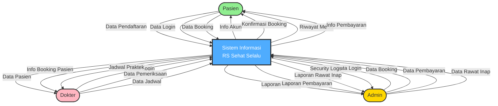
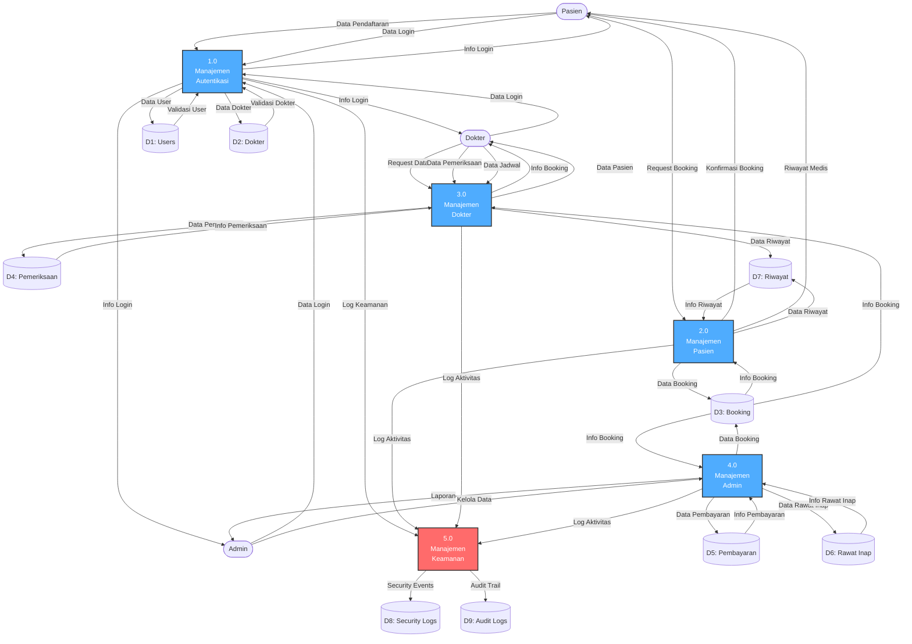
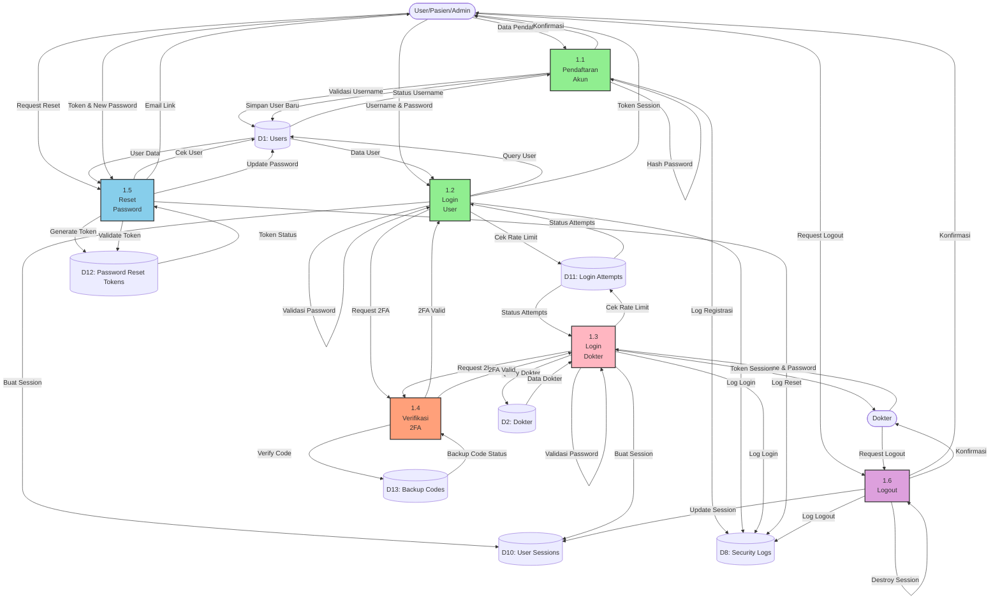
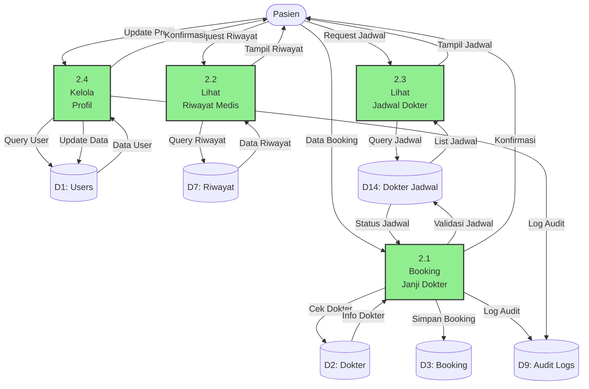
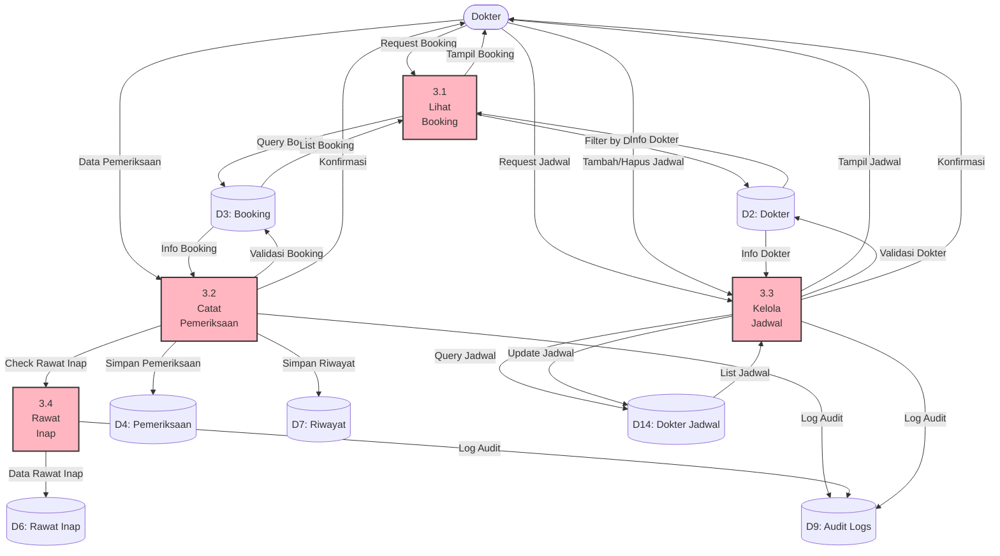
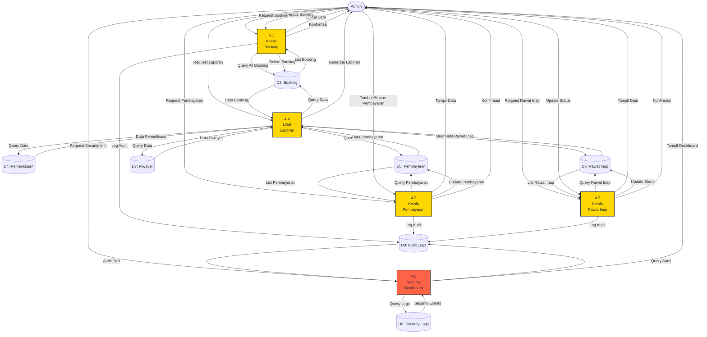
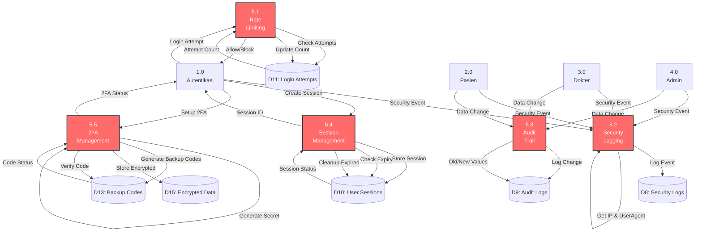

# Data Flow Diagram (DFD)
## Sistem Informasi RS Sehat Selalu

---

## Diagram Konteks (Context Diagram / DFD Level 0)

---

## DFD Level 1 - Dekomposisi Sistem Utama

---

## DFD Level 2 - Proses 1.0: Manajemen Autentikasi

---

## DFD Level 2 - Proses 2.0: Manajemen Pasien

---

## DFD Level 2 - Proses 3.0: Manajemen Dokter

---

## DFD Level 2 - Proses 4.0: Manajemen Admin

---

## DFD Level 2 - Proses 5.0: Manajemen Keamanan

---

## Kamus Data (Data Dictionary)

### Data Flows:

| Nama Data Flow | Deskripsi | Struktur Data |
|----------------|-----------|---------------|
| **Data Pendaftaran** | Data untuk registrasi akun baru | username + password + confirm_password + csrf_token |
| **Data Login** | Kredensial untuk autentikasi | username + password + csrf_token |
| **Data Booking** | Informasi booking appointment | pasien + dokter + tanggal + hari + jam + keluhan + csrf_token |
| **Data Pemeriksaan** | Hasil pemeriksaan medis | pasien + dokter + diagnosa + obat + tanggal + csrf_token |
| **Data Pembayaran** | Transaksi pembayaran | pasien + jumlah + keterangan + tanggal + csrf_token |
| **Data Rawat Inap** | Informasi rawat inap | pasien + dokter + alasan + status + tanggal |
| **Data Jadwal** | Jadwal praktek dokter | dokter + hari + jam |
| **Riwayat Medis** | History pemeriksaan pasien | pasien + dokter + tanggal + diagnosa |
| **Security Event** | Event keamanan sistem | user_id + event_type + details + ip_address + user_agent + timestamp |
| **Audit Trail** | Log perubahan data | table_name + record_id + action + old_values + new_values + user_id + timestamp |
| **Token Session** | Session identifier | session_id + user_id + expires_at + ip_address |
| **2FA Code** | Kode Two-Factor Auth | code (6 digit) + timestamp |

### Data Stores:

| ID | Nama Data Store | Deskripsi | Struktur |
|----|-----------------|-----------|----------|
| **D1** | Users | Data pengguna sistem | id + username + password + role + 2fa_secret + 2fa_enabled + created_at + updated_at + last_login + login_attempts + account_locked |
| **D2** | Dokter | Data dokter | id + username + password + nama + 2fa_secret + 2fa_enabled + created_at + updated_at + last_login |
| **D3** | Booking | Data booking appointment | id + pasien + dokter + tanggal + hari + jam + keluhan |
| **D4** | Pemeriksaan | Data hasil pemeriksaan | id + pasien + dokter + diagnosa + obat + tanggal |
| **D5** | Pembayaran | Data transaksi pembayaran | id + pasien + jumlah + keterangan + tanggal |
| **D6** | Rawat Inap | Data pasien rawat inap | id + pasien + dokter + alasan + status + tanggal |
| **D7** | Riwayat | Riwayat medis pasien | id + pasien + dokter + tanggal + diagnosa |
| **D8** | Security Logs | Log event keamanan | id + user_id + event_type + details + ip_address + user_agent + timestamp |
| **D9** | Audit Logs | Log perubahan data | id + table_name + record_id + action + old_values + new_values + user_id + timestamp |
| **D10** | User Sessions | Sesi aktif pengguna | id + user_id + session_id + ip_address + user_agent + created_at + expires_at + is_active |
| **D11** | Login Attempts | Percobaan login | id + identifier + ip_address + username + success + timestamp + user_agent |
| **D12** | Password Reset Tokens | Token reset password | id + user_id + token + expires_at + used + created_at |
| **D13** | Backup Codes | Kode backup 2FA | id + user_id + code + used + created_at + used_at |
| **D14** | Dokter Jadwal | Jadwal praktek dokter | id + dokter + hari + jam |
| **D15** | Encrypted Data | Data terenkripsi | id + table_name + record_id + field_name + encrypted_value + created_at |

### External Entities:

| Nama Entity | Deskripsi | Interaksi |
|-------------|-----------|-----------|
| **Pasien** | Pengguna yang mendaftar sebagai pasien | Pendaftaran, Login, Booking, Lihat Riwayat |
| **Dokter** | Tenaga medis yang menangani pasien | Login, Lihat Booking, Catat Pemeriksaan, Kelola Jadwal |
| **Admin** | Administrator sistem | Login, Kelola Booking, Kelola Pembayaran, Kelola Rawat Inap, Lihat Laporan, Security Dashboard |

---

## Proses Utama (Main Processes):

### Level 1:

| ID | Nama Proses | Deskripsi | Input | Output |
|----|-------------|-----------|-------|--------|
| **1.0** | Manajemen Autentikasi | Mengelola login, registrasi, 2FA | Data Login, Data Pendaftaran | Token Session, Konfirmasi |
| **2.0** | Manajemen Pasien | Mengelola aktivitas pasien | Request Booking, Request Riwayat | Konfirmasi, Data Riwayat |
| **3.0** | Manajemen Dokter | Mengelola aktivitas dokter | Data Pemeriksaan, Data Jadwal | Konfirmasi, Info Booking |
| **4.0** | Manajemen Admin | Mengelola data sistem | Data CRUD | Laporan, Konfirmasi |
| **5.0** | Manajemen Keamanan | Mengelola keamanan sistem | Security Events, Data Changes | Logs, Audit Trail |

### Level 2 - Proses 1.0:

| ID | Nama Proses | Deskripsi |
|----|-------------|-----------|
| **1.1** | Pendaftaran Akun | Registrasi user baru dengan validasi |
| **1.2** | Login User | Autentikasi user/admin dengan 2FA |
| **1.3** | Login Dokter | Autentikasi dokter dengan 2FA |
| **1.4** | Verifikasi 2FA | Validasi kode Two-Factor Authentication |
| **1.5** | Reset Password | Reset password dengan token email |
| **1.6** | Logout | Destroy session dan cleanup |

### Level 2 - Proses 2.0:

| ID | Nama Proses | Deskripsi |
|----|-------------|-----------|
| **2.1** | Booking Janji Dokter | Pasien membuat appointment dengan dokter |
| **2.2** | Lihat Riwayat Medis | Pasien melihat history pemeriksaan |
| **2.3** | Lihat Jadwal Dokter | Pasien melihat jadwal praktek dokter |
| **2.4** | Kelola Profil | Pasien update data profil |

### Level 2 - Proses 3.0:

| ID | Nama Proses | Deskripsi |
|----|-------------|-----------|
| **3.1** | Lihat Booking | Dokter melihat daftar booking pasien |
| **3.2** | Catat Pemeriksaan | Dokter mencatat hasil pemeriksaan |
| **3.3** | Kelola Jadwal | Dokter manage jadwal praktek |
| **3.4** | Rawat Inap | Dokter request rawat inap untuk pasien |

### Level 2 - Proses 4.0:

| ID | Nama Proses | Deskripsi |
|----|-------------|-----------|
| **4.1** | Kelola Booking | Admin CRUD data booking |
| **4.2** | Kelola Pembayaran | Admin CRUD data pembayaran |
| **4.3** | Kelola Rawat Inap | Admin CRUD data rawat inap |
| **4.4** | Lihat Laporan | Admin generate laporan sistem |
| **4.5** | Security Dashboard | Admin monitoring keamanan |

### Level 2 - Proses 5.0:

| ID | Nama Proses | Deskripsi |
|----|-------------|-----------|
| **5.1** | Rate Limiting | Mencegah brute force attack |
| **5.2** | Security Logging | Mencatat semua security events |
| **5.3** | Audit Trail | Mencatat semua perubahan data |
| **5.4** | Session Management | Mengelola sesi pengguna aktif |
| **5.5** | 2FA Management | Mengelola Two-Factor Authentication |

---

## Karakteristik DFD:

### Notasi yang Digunakan:
- **External Entity (Oval):** Entitas luar sistem (Pasien, Dokter, Admin)
- **Process (Rectangle):** Proses/transformasi data
- **Data Store (Cylinder):** Penyimpanan data (Database tables)
- **Data Flow (Arrow):** Aliran data antar komponen

### Aturan DFD:
1. ✅ Setiap proses harus memiliki input dan output
2. ✅ Data flow harus memiliki nama yang deskriptif
3. ✅ Data store harus diakses minimal satu proses
4. ✅ External entity tidak berkomunikasi langsung
5. ✅ Dekomposisi dilakukan secara konsisten
6. ✅ Balanced DFD (input/output konsisten antar level)

### Fitur Keamanan dalam DFD:
- 🔒 CSRF Token di setiap data flow input
- 🔒 Rate Limiting untuk mencegah abuse
- 🔒 Security Logging untuk audit
- 🔒 Session Management untuk tracking
- 🔒 2FA untuk autentikasi kuat
- 🔒 Audit Trail untuk compliance
- 🔒 Password Hashing (tidak ditampilkan plain text)
- 🔒 Encrypted Data Storage

---

**Dibuat untuk:** RS Sehat Selalu  
**Format:** Mermaid Flowchart  
**Tanggal:** 2025  
**Versi:** 1.0
