# Entity Relationship Diagram (ERD)
## Sistem Informasi RS Sehat Selalu

```mermaid
erDiagram
    USERS ||--o{ BOOKING : "membuat"
    USERS ||--o{ PEMERIKSAAN : "mendapat"
    USERS ||--o{ PEMBAYARAN : "melakukan"
    USERS ||--o{ RAWAT_INAP : "menjalani"
    USERS ||--o{ RIWAYAT : "memiliki"
    USERS ||--o{ BACKUP_CODES : "memiliki"
    USERS ||--o{ USER_SESSIONS : "memiliki"
    USERS ||--o{ PASSWORD_RESET_TOKENS : "memiliki"
    USERS ||--o{ SECURITY_LOGS : "tercatat"
    USERS ||--o{ AUDIT_LOGS : "melakukan"
    
    DOKTER ||--o{ DOKTER_JADWAL : "memiliki"
    DOKTER ||--o{ BOOKING : "menerima"
    DOKTER ||--o{ PEMERIKSAAN : "melakukan"
    DOKTER ||--o{ RAWAT_INAP : "menangani"
    DOKTER ||--o{ RIWAYAT : "mencatat"

    USERS {
        int id PK "Primary Key"
        varchar username UK "Unique, Not Null"
        varchar password "Not Null, Hashed (255)"
        enum role "admin/pasien"
        varchar two_factor_secret "Nullable"
        tinyint two_factor_enabled "Default 0"
        timestamp created_at "Auto"
        timestamp updated_at "Auto"
        timestamp last_login "Nullable"
        int login_attempts "Default 0"
        tinyint account_locked "Default 0"
        timestamp password_changed_at "Auto"
    }

    DOKTER {
        int id PK "Primary Key"
        varchar username "Nullable"
        varchar password "Not Null (255)"
        varchar nama "Nullable"
        varchar two_factor_secret "Nullable"
        tinyint two_factor_enabled "Default 0"
        timestamp created_at "Auto"
        timestamp updated_at "Auto"
        timestamp last_login "Nullable"
        int login_attempts "Default 0"
        tinyint account_locked "Default 0"
        timestamp password_changed_at "Auto"
    }

    BOOKING {
        int id PK "Primary Key"
        varchar pasien "Not Null"
        varchar dokter "Not Null"
        date tanggal "Not Null"
        varchar hari "Not Null"
        varchar jam "Not Null"
        varchar keluhan "Not Null"
    }

    DOKTER_JADWAL {
        int id PK "Primary Key"
        varchar dokter "Nullable"
        varchar hari "Nullable"
        varchar jam "Nullable"
    }

    PEMBAYARAN {
        int id PK "Primary Key"
        varchar pasien "Nullable"
        int jumlah "Nullable"
        text keterangan "Nullable"
        date tanggal "Nullable"
    }

    PEMERIKSAAN {
        int id PK "Primary Key"
        varchar pasien "Nullable"
        varchar dokter "Nullable"
        text diagnosa "Nullable"
        text obat "Nullable"
        date tanggal "Nullable"
    }

    RAWAT_INAP {
        int id PK "Primary Key"
        varchar pasien "Nullable"
        varchar dokter "Nullable"
        text alasan "Nullable"
        varchar status "Default: Menunggu"
        timestamp tanggal "Auto"
    }

    RIWAYAT {
        int id PK "Primary Key"
        varchar pasien "Nullable"
        varchar dokter "Nullable"
        date tanggal "Nullable"
        text diagnosa "Nullable"
    }

    BACKUP_CODES {
        int id PK "Primary Key"
        int user_id FK "Not Null"
        varchar code "Not Null"
        tinyint used "Default 0"
        timestamp created_at "Auto"
        timestamp used_at "Nullable"
    }

    USER_SESSIONS {
        int id PK "Primary Key"
        int user_id FK "Not Null"
        varchar session_id "Not Null (128)"
        varchar ip_address "Not Null"
        text user_agent "Nullable"
        timestamp created_at "Auto"
        timestamp last_activity "Auto Update"
        timestamp expires_at "Not Null"
        tinyint is_active "Default 1"
    }

    PASSWORD_RESET_TOKENS {
        int id PK "Primary Key"
        int user_id FK "Not Null"
        varchar token "Not Null (128)"
        timestamp expires_at "Not Null"
        tinyint used "Default 0"
        timestamp created_at "Auto"
        timestamp used_at "Nullable"
    }

    SECURITY_LOGS {
        int id PK "Primary Key"
        int user_id FK "Nullable"
        varchar event_type "Not Null"
        text details "Nullable"
        varchar ip_address "Not Null"
        text user_agent "Nullable"
        timestamp timestamp "Auto"
    }

    LOGIN_ATTEMPTS {
        int id PK "Primary Key"
        varchar identifier "Not Null"
        varchar ip_address "Not Null"
        varchar username "Nullable"
        tinyint success "Default 0"
        int timestamp "Not Null"
        text user_agent "Nullable"
    }

    AUDIT_LOGS {
        int id PK "Primary Key"
        varchar table_name "Not Null"
        int record_id "Not Null"
        varchar action "INSERT/UPDATE/DELETE"
        json old_values "Nullable"
        json new_values "Nullable"
        int user_id FK "Nullable"
        varchar ip_address "Nullable"
        timestamp timestamp "Auto"
    }

    ENCRYPTED_DATA {
        int id PK "Primary Key"
        varchar table_name "Not Null"
        int record_id "Not Null"
        varchar field_name "Not Null"
        text encrypted_value "Not Null"
        timestamp created_at "Auto"
        timestamp updated_at "Auto"
    }

    ENCRYPTION_KEYS {
        int id PK "Primary Key"
        varchar key_name UK "Not Null, Unique"
        varchar key_value "Not Null"
        timestamp created_at "Auto"
        timestamp rotated_at "Nullable"
        tinyint is_active "Default 1"
    }
```

---

## Deskripsi Tabel

### 1. **USERS** (Tabel Pengguna)
Menyimpan data pengguna sistem (admin dan pasien)
- Primary Key: `id`
- Unique Key: `username`
- Role: admin atau pasien
- Fitur Keamanan: 2FA, login attempts, account lock

### 2. **DOKTER** (Tabel Dokter)
Menyimpan data dokter yang bertugas
- Primary Key: `id`
- Memiliki credential login terpisah
- Fitur Keamanan: 2FA, login attempts, account lock

### 3. **BOOKING** (Tabel Booking Janji)
Menyimpan data janji temu pasien dengan dokter
- Primary Key: `id`
- Foreign Reference: pasien (username), dokter (username)
- Berisi: tanggal, hari, jam, keluhan

### 4. **DOKTER_JADWAL** (Tabel Jadwal Dokter)
Menyimpan jadwal praktek dokter
- Primary Key: `id`
- Foreign Reference: dokter (username)
- Berisi: hari, jam praktek

### 5. **PEMBAYARAN** (Tabel Pembayaran)
Menyimpan transaksi pembayaran pasien
- Primary Key: `id`
- Foreign Reference: pasien (username)
- Berisi: jumlah, keterangan, tanggal

### 6. **PEMERIKSAAN** (Tabel Pemeriksaan)
Menyimpan hasil pemeriksaan medis
- Primary Key: `id`
- Foreign Reference: pasien, dokter (username)
- Berisi: diagnosa, obat, tanggal

### 7. **RAWAT_INAP** (Tabel Rawat Inap)
Menyimpan data pasien rawat inap
- Primary Key: `id`
- Foreign Reference: pasien, dokter (username)
- Status: Menunggu, Disetujui, Ditolak

### 8. **RIWAYAT** (Tabel Riwayat Medis)
Menyimpan riwayat medis pasien
- Primary Key: `id`
- Foreign Reference: pasien, dokter (username)
- Berisi: tanggal, diagnosa

### 9. **BACKUP_CODES** (Tabel Kode Backup 2FA)
Menyimpan kode backup untuk 2FA
- Primary Key: `id`
- Foreign Key: `user_id` → USERS(id) CASCADE DELETE
- Berisi: code, status used

### 10. **USER_SESSIONS** (Tabel Sesi Pengguna)
Menyimpan sesi login aktif pengguna
- Primary Key: `id`
- Foreign Key: `user_id` → USERS(id) CASCADE DELETE
- Berisi: session_id, IP, user agent, expire time

### 11. **PASSWORD_RESET_TOKENS** (Tabel Token Reset Password)
Menyimpan token untuk reset password
- Primary Key: `id`
- Foreign Key: `user_id` → USERS(id) CASCADE DELETE
- Berisi: token, expires_at, status used

### 12. **SECURITY_LOGS** (Tabel Log Keamanan)
Mencatat semua event keamanan sistem
- Primary Key: `id`
- Foreign Key: `user_id` → USERS(id) SET NULL
- Berisi: event_type, details, IP, user agent

### 13. **LOGIN_ATTEMPTS** (Tabel Percobaan Login)
Mencatat semua percobaan login untuk rate limiting
- Primary Key: `id`
- Berisi: identifier, IP, username, success status
- Digunakan untuk mencegah brute force attack

### 14. **AUDIT_LOGS** (Tabel Audit Trail)
Mencatat semua perubahan data (INSERT, UPDATE, DELETE)
- Primary Key: `id`
- Foreign Key: `user_id` → USERS(id) SET NULL
- Berisi: table_name, record_id, old/new values (JSON)

### 15. **ENCRYPTED_DATA** (Tabel Data Terenkripsi)
Menyimpan data sensitif yang terenkripsi
- Primary Key: `id`
- Berisi: table_name, record_id, field_name, encrypted_value
- Untuk menyimpan data sensitif seperti NIK, alamat, dll

### 16. **ENCRYPTION_KEYS** (Tabel Kunci Enkripsi)
Menyimpan kunci enkripsi untuk data sensitif
- Primary Key: `id`
- Unique Key: `key_name`
- Berisi: key_value, status active, rotation info

---

## Relasi Antar Tabel

### Relasi Utama:
1. **USERS → BOOKING** (One-to-Many)
   - Satu pasien dapat membuat banyak booking

2. **DOKTER → BOOKING** (One-to-Many)
   - Satu dokter dapat menerima banyak booking

3. **DOKTER → DOKTER_JADWAL** (One-to-Many)
   - Satu dokter memiliki banyak jadwal praktek

4. **USERS → PEMERIKSAAN** (One-to-Many)
   - Satu pasien dapat memiliki banyak pemeriksaan

5. **DOKTER → PEMERIKSAAN** (One-to-Many)
   - Satu dokter dapat melakukan banyak pemeriksaan

6. **USERS → PEMBAYARAN** (One-to-Many)
   - Satu pasien dapat melakukan banyak pembayaran

7. **USERS → RAWAT_INAP** (One-to-Many)
   - Satu pasien dapat menjalani banyak rawat inap

8. **DOKTER → RAWAT_INAP** (One-to-Many)
   - Satu dokter dapat menangani banyak rawat inap

9. **USERS → RIWAYAT** (One-to-Many)
   - Satu pasien memiliki banyak riwayat medis

### Relasi Keamanan:
10. **USERS → BACKUP_CODES** (One-to-Many, CASCADE)
    - Satu user memiliki banyak backup codes untuk 2FA

11. **USERS → USER_SESSIONS** (One-to-Many, CASCADE)
    - Satu user dapat memiliki banyak sesi aktif

12. **USERS → PASSWORD_RESET_TOKENS** (One-to-Many, CASCADE)
    - Satu user dapat memiliki banyak token reset password

13. **USERS → SECURITY_LOGS** (One-to-Many, SET NULL)
    - Satu user tercatat dalam banyak log keamanan

14. **USERS → AUDIT_LOGS** (One-to-Many, SET NULL)
    - Satu user melakukan banyak perubahan data

---

## Indexes (untuk Optimasi)

### Primary Indexes:
- Semua tabel memiliki PRIMARY KEY pada kolom `id`

### Unique Indexes:
- `users.username` (UNIQUE)
- `encryption_keys.key_name` (UNIQUE)

### Foreign Key Indexes:
- `backup_codes.user_id`
- `user_sessions.user_id`
- `password_reset_tokens.user_id`
- `security_logs.user_id`
- `audit_logs.user_id`

### Performance Indexes:
- `users.username`
- `users.last_login`
- `dokter.username`
- `dokter.last_login`
- `login_attempts.identifier`
- `login_attempts.timestamp`
- `security_logs.event_type`
- `security_logs.timestamp`
- `user_sessions.session_id`
- `user_sessions.expires_at`
- `password_reset_tokens.token`
- `password_reset_tokens.expires_at`
- `audit_logs.table_name, record_id`
- `encrypted_data.table_name, record_id`

---

## Catatan Penting:

1. **Keamanan Data:**
   - Password di-hash menggunakan bcrypt (VARCHAR 255)
   - Implementasi Two-Factor Authentication (2FA)
   - Rate limiting untuk mencegah brute force
   - Account locking setelah beberapa percobaan gagal
   - Audit trail untuk semua perubahan data

2. **Session Management:**
   - Tracking semua sesi aktif pengguna
   - Auto cleanup sesi yang expired
   - Multi-device support

3. **Data Encryption:**
   - Data sensitif dapat dienkripsi
   - Key rotation support
   - Separate table untuk encrypted data

4. **Audit & Logging:**
   - Complete audit trail (INSERT, UPDATE, DELETE)
   - Security event logging
   - Login attempts tracking

5. **Data Integrity:**
   - Foreign key constraints
   - Cascade delete untuk data terkait
   - Set NULL untuk log history

6. **Performance:**
   - Proper indexing pada kolom yang sering di-query
   - JSON datatype untuk flexible audit data
   - Automatic cleanup via scheduled events

---

## Stored Procedures:

1. **CleanupLoginAttempts()** - Membersihkan login attempts > 1 jam
2. **CleanupExpiredSessions()** - Membersihkan sesi yang expired
3. **LogSecurityEvent()** - Mencatat event keamanan

## Scheduled Events:

1. **cleanup_login_attempts** - Setiap 1 jam
2. **cleanup_expired_sessions** - Setiap 30 menit

---

**Dibuat untuk:** RS Sehat Selalu  
**Versi Database:** MySQL/MariaDB  
**Tanggal:** 2025
